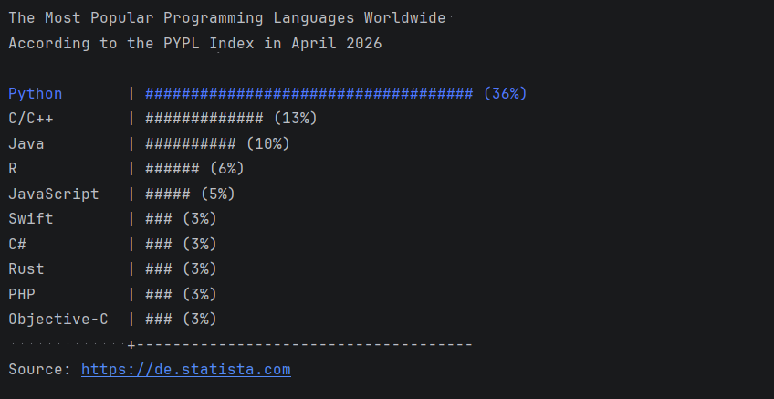
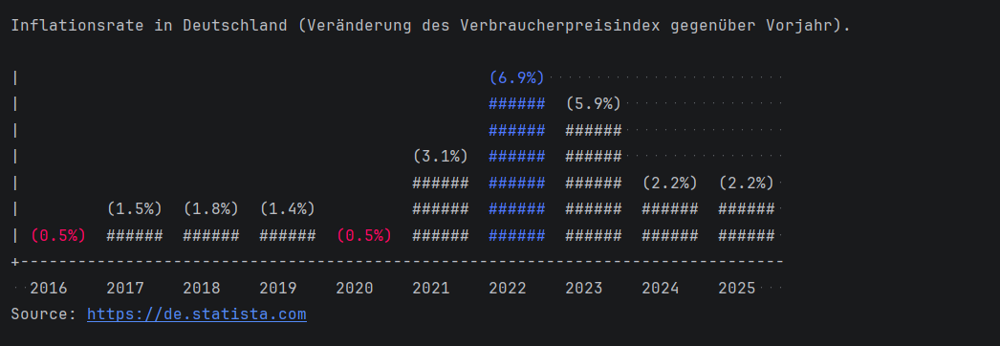

# Terminal Chart Library (WIP)

> A lightweight, modular Python library for rendering vertical and horizontal ASCII barcharts in the terminal. Built with a strong focus on clean architecture, robust input validation, and enterprise-grade test automation.

| Horizontal Barchart                                                  | Vertical Barchart                                                |
|----------------------------------------------------------------------|------------------------------------------------------------------|
|  |  |

## Engineering Highlights & Best Practices: 
This project was built to demonstrate professional software engineering standards, moving far beyond a basic script:

- Advanced Test Automation (pytest):
    - Utilizes complex @pytest.mark.parametrize matrices to test multiple chart types against broad datasets and invalid inputs efficiently.
    - Strict adherence to the Single Responsibility Principle (SRP) and Black-Box Testing (testing via Public APIs rather than internal state).

- CI/CD Quality Gate:
  - Integrated GitHub Actions (.github/workflows/test.yml) to automatically trigger the test suite on every push, ensuring zero regressions.

- Scalable Object-Oriented Design:
    - Shared base classes implementing the DRY (Don't Repeat Yourself) principle for core logic (like strict validation protocols for colors and numerical inputs) while specializing rendering behavior for vertical and horizontal layouts.

- Robust Error Handling:
    - Precise type and range validation (ValueError, TypeError, KeyError) with dedicated negative test cases to guarantee system stability.

## Architecture Overview
```
chart_library/
├── library/
│   └── charts.py          # barchart logic (for now)
├── pytests/
│   └── test_barchart.py   # barchart tests (for now)
└── .github/
    └── workflows/
        └── test.yml       # Automated CI pipeline
```


## Quick Start & Usage

### Installation
Simply copy chart.py into your project or include it as a module.

### Basic Usage

```Python
from library.charts import Barchart_vertical, Barchart_horizontal
```

### Initialize with data

```Python
data = {"Apple": 10, "Banana": 4, "Orange": 20}

chart_v = Barchart_vertical(data)
chart_h = Barchart_horizontal(data)
```

### Print the chart

```Python
print(chart_v)
print(chart_h)
```

### Advanced Customization

```Python
# Customize appearance
chart_h.scale = 1.5
chart_h.sign = "#"
chart_h.xunit = "%"
chart_h.value_at_end = True

# Add colors (RGB tuples: 0-255)
chart_h.color = (50, 200, 255)         # Global chart color (Blue/Cyan)
chart_h.highlight_max = (0, 255, 0)    # Highlight highest value in Green
chart_h.highlight_min = (255, 0, 0)    # Highlight lowest value in Red

print(chart_h)
```

### Combining Charts

You can add two charts together. Duplicate keys will automatically have their values aggregated:

```Python
chart1 = Barchart_horizontal({"Apple": 10, "Banana": 5})
chart2 = Barchart_horizontal({"Apple": 5, "Cherry": 7})

combined = chart1 + chart2
print(combined)
# Apple will now have a value of 15!
```

## Configuration Options

| Attribute | Type | Default | Description |
|---|---|---|---|
| scale | int / float | 1 | Multiplier for the bar length. Must be > 0 |
| sign | str | # | Character used to draw the bars (must be a single character) |
| xunit | str | "%" | Unit string displayed next to the value|
| value_at_end | bool | True | Whether to display the numerical value at the end of the bar |
| color | tuple | None | Global RGB color tuple (R, G, B) for the chart|
| highlight_max | tuple | None | RGB color tuple for the maximum value in the chart | 
| highlight_min | tuple | None | RGB color tuple for the minimum value in the chart.|

## Error Handling (Fail Fast)

Chart-Library follows a strict validation policy:
- Negative values or scales raise a ValueError.
- Invalid types (e.g., passing a string where a number is expected, or a color tuple with out-of-range values) raise a TypeError.
- Non-existent keys accessed via brackets raise a KeyError.

## Running the Test Suite

To run the automated tests locally with pytest:

```Bash
# Install dependencies
pip install pytest

# Run the test suite with verbose output
pytest -v
```
